# NILM Smart Energy: AI-Powered Non-Intrusive Load Monitoring System

NED University of Engineering & Technology, Department of Computer Science & Information Technology  
CT-466 Artificial Neural Networks, Complex Computing Problem (CLO-3)

## 1. Introduction

A smart meter records the total power of a home. It does not say which appliance used that power. Non-Intrusive Load Monitoring (NILM) estimates the appliances from the total signal alone, without a meter on each circuit. This project builds six artificial neural networks that do this on real 1-minute data from Pecan Street.

## 2. Problem statement

Given only the whole-house power of a home, predict for each selected appliance (a) whether it is ON or OFF and (b) how much power it uses. Appliance-level readings are used only as the correct answers during training and evaluation. They are never a model input.

## 3. NILM concept

Each appliance leaves a pattern in the total power: the air conditioner adds about 2 to 4 kW for long cycles, the dryer adds 2 to 6 kW for about an hour, EV charging adds a flat 3.3 or 7.2 kW block, and the refrigerator adds a small 70 to 150 W cycle. A model that sees the last 180 minutes of total power can learn these shapes. Example: if the total is 3,200 W and the AC circuit reads 1,400 W, the input is the 3,200 W history, the AC power target is 1,400 W and the AC label is ON.

## 4. Objectives

1. Select at least 5 homes and 3 appliances with real ON and OFF readings.
2. Build a leakage-free pipeline: cleaning, training-only thresholds, time-ordered splits, windows that never cross a split.
3. Train six ANN models (MLP, 1D-CNN, LSTM, GRU, CNN-LSTM, TCN) on identical data.
4. Report Accuracy, Balanced Accuracy, Macro-F1, MAE and RMSE per appliance on unseen test data and compare the models.

## 5. Dataset region

Region: **Austin, Texas (Pecan Street 1-minute, 2018)**. Only the Austin file was used. The Austin file has 25 homes with readings for all of 2018 (13,100,539 rows, 79 columns). It had enough homes and appliances, so no other region was needed.

## 6. Selected homes

Development homes (train/validation/test): **661, 4373, 4767, 6139, 8156**. These are the only 5 Austin homes where the AC, dryer and EV charger all have real ON periods.  
Unseen homes (evaluation only): **1642, 7719**. They are never used for training, validation, thresholds or scaling.

| home | raw_rows | missing_minutes | has_solar | role | air1 | drye1 | car1 | refrigerator1 |
|---|---|---|---|---|---|---|---|---|
| 661 | 525530 | 5050 | True | development | yes | yes | yes | yes |
| 4373 | 518040 | 7620 | True | development | yes | yes | yes | yes |
| 4767 | 524440 | 20 | True | development | yes | yes | yes | yes |
| 6139 | 525368 | 344 | True | development | yes | yes | yes | not metered |
| 8156 | 524820 | 840 | True | development | yes | yes | yes | yes |
| 1642 | 519780 | 8520 | True | unseen test | yes | yes | yes | yes |
| 7719 | 523260 | 2340 | True | unseen test | yes | not metered | yes | yes |

## 7. Selected appliances

Air conditioner (`air1`), electric dryer (`drye1`) and EV charging (`car1`) form the compulsory 3-appliance benchmark. The refrigerator (`refrigerator1`) is a fourth, optional appliance. It is not metered in home 6139, so its targets there are masked. Home 1642 has a dryer meter but the dryer was never used in 2018, and home 7719 has no dryer meter, so the unseen-home dryer result has no ON samples.

## 8. Dataset columns

| column | meaning | use |
|---|---|---|
| `dataid` | home ID | select homes, never a model input |
| `localminute` | local time with offset (-06 CST, -05 CDT) | converted to UTC |
| `grid` | net power from the utility, kW (negative when solar exports) | input |
| `solar`, `solar2` | PV generation, kW | input |
| `air1`, `drye1`, `car1`, `refrigerator1` | circuit power, kW | targets only |

## 9. Data cleaning and preprocessing

1. Read only the needed columns in chunks (the file is 2.6 GB).
2. Parse timestamps to UTC. The file mixes -06 and -05 offsets because of daylight saving; UTC gives one continuous minute line with no repeated hour.
3. Sort, drop duplicate timestamps (none were found), and reindex every home to a full 1-minute timeline.
4. Fill missing runs of up to 5 minutes by linear interpolation. Longer gaps stay missing and no window may contain them.
5. Appliance readings between -0.05 and 0 kW are sensor noise and set to 0. Lower values, or readings above the whole-house power plus 0.1 kW, are physically impossible and marked invalid (masked), not deleted and not set to zero.
6. All power stays in kW inside the code; errors are reported in W.

| home | missing_minutes | aggregate_interpolated | air1_invalid_over_aggregate | drye1_invalid_over_aggregate | car1_invalid_over_aggregate | refrigerator1_invalid_over_aggregate |
|---|---|---|---|---|---|---|
| 661 | 5050 | 0 | 0 | 0.0 | 0 | 21.0 |
| 4373 | 7620 | 0 | 0 | 271.0 | 218 | 10.0 |
| 4767 | 20 | 0 | 0 | 0.0 | 0 | 0.0 |
| 6139 | 344 | 344 | 0 | 0.0 | 1702 | - |
| 8156 | 840 | 0 | 0 | 29.0 | 0 | 0.0 |
| 1642 | 8520 | 0 | 0 | 0.0 | 0 | 0.0 |
| 7719 | 2340 | 0 | 0 | - | 0 | 0.0 |

## 10. Whole-house power reconstruction

In Pecan Street data `grid` is the net import from the utility. It turns negative when the solar panels export. The real consumption of the home is therefore **aggregate = grid + solar + solar2**. All 7 selected homes have a `solar` column; none has `solar2`, so it counts as 0. A minute with a missing grid or solar reading has no valid aggregate. Small negative solar values at night (inverter standby) are kept because they are part of the real balance.

## 11. ON/OFF threshold

Threshold per appliance = max(0.02 kW, 10% of the 99th percentile of that appliance's power in the **training** minutes of the development homes). Validation and test data were not used. Power above the threshold is ON (1), otherwise OFF (0).

| appliance | training p99 (kW) | threshold (kW) |
|---|---|---|
| Air Conditioner (air1) | 3.532 | 0.3532 |
| Electric Dryer (drye1) | 2.704 | 0.2704 |
| EV Charging (car1) | 3.705 | 0.3705 |
| Refrigerator (refrigerator1) | 0.354 | 0.0354 |

## 12. ON/OFF class counts

Counts are the labels at the last minute of every valid input window.

| appliance | train ON | train OFF | val ON | val OFF | test ON | test OFF | unseen ON | unseen OFF |
|---|---|---|---|---|---|---|---|---|
| air1 | 400188 | 1414754 | 90187 | 288625 | 97183 | 286106 | 196986 | 842220 |
| car1 | 144763 | 1620206 | 28049 | 338704 | 30750 | 341400 | 44800 | 994406 |
| drye1 | 35464 | 1778964 | 7939 | 370819 | 9097 | 374100 | 0 | 516483 |
| refrigerator1 | 1034135 | 387984 | 215992 | 75999 | 219717 | 80750 | 913126 | 108674 |

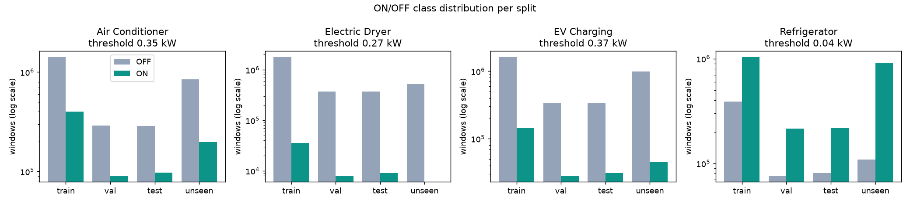

## 13. Training, validation and test split

Split mode: **monthly**, ratios 70/15/15, no shuffling. Inside every calendar month of each development home, the first 70% of minutes are training, the next 15% validation and the last 15% test.

Why not one 70/15/15 split of the whole year? We tested it first. It puts the test set at 7 November to 31 December, when the air conditioner is ON in only 0.6% of test minutes (2,533 of 394,029) against 27.5% in training. The AC test score would then measure the season, not the model. The monthly split keeps the time order inside each month and gives every split all seasons (AC ON share: train 22.1%, validation 23.8%, test 25.4%). The global split is still available (`SPLIT_MODE = "global"` in `src/utils.py`).

Leakage control: windows never cross a split, a home or a long gap. Thresholds, input scaling, power scaling and class weights come from training data only. The ON probability cut-off of each model is chosen on validation data only. The two unseen homes add a stricter test: whole homes the models never saw.

## 14. Input window

Each sample is 180 consecutive minutes of aggregate power, scaled with the training mean (1.767 kW) and standard deviation (1.900 kW). The targets are the ON/OFF label and power of every appliance at the last minute of the window. Home ID, time and appliance readings are never inputs.

## 15. Six ANN architectures

All six share the same input and the same two output heads: a classification head (one ON logit per appliance) and a regression head (one non-negative power value per appliance, through softplus).

| model | feature layers |
|---|---|
| MLP (baseline) | Dense 256, 128, 64 (ReLU), dropout 0.2 |
| 1D-CNN | Conv 16, Conv 32, MaxPool, Conv 32, MaxPool, Dense 128 |
| LSTM | LSTM 64, dropout 0.2, Dense 64 |
| GRU | GRU 64, dropout 0.2, Dense 64 |
| CNN-LSTM | Conv 16 (k5), MaxPool, Conv 32 (k3), LSTM 32, dropout 0.2, Dense 64 |
| TCN | causal Conv 16 (dilation 1), causal Conv 32 (dilation 2), dropout 0.2, average pool + last step, Dense 64 |

## 16. Training method

PyTorch, Adam, learning rate 0.001, batch 512, seed 42, up to 30 epochs, early stopping after 5 epochs without validation improvement, best checkpoint kept. Loss = masked BCEWithLogits (with positive class weights from training labels) + masked Smooth L1 on power scaled by the training 99th percentile. Only valid targets count. To keep CPU time reasonable, every model trains on the same fixed random sample of 200,000 training windows and early-stops on the same 60,000 validation windows. The test set is used in full and is not balanced or changed.

| model | epochs run | best epoch | best val loss |
|---|---|---|---|
| MLP | 13 | 8 | 0.378 |
| 1D-CNN | 13 | 8 | 0.2658 |
| LSTM | 23 | 18 | 0.2309 |
| GRU | 19 | 14 | 0.2313 |
| CNN-LSTM | 24 | 19 | 0.2441 |
| TCN | 30 | 30 | 0.2766 |

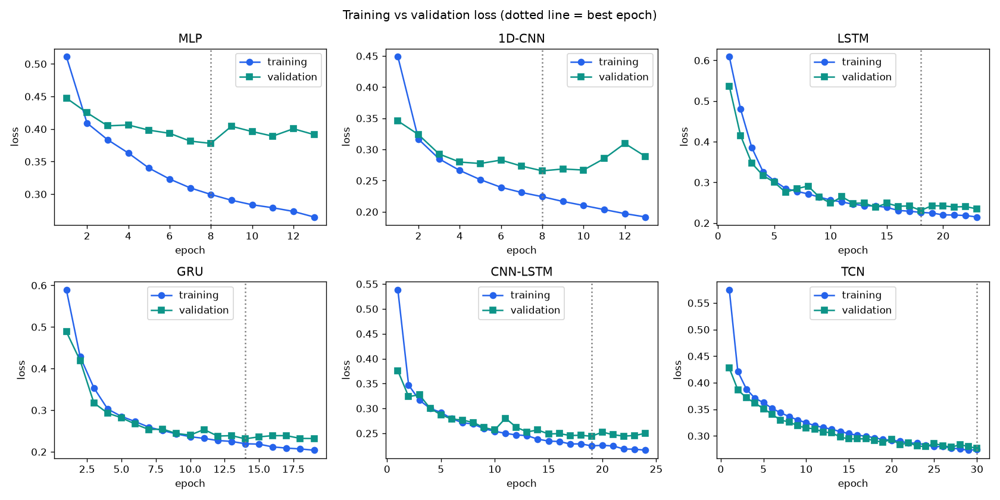

## 17. Classification evaluation

Per appliance on the test set: Accuracy, Balanced Accuracy (mean of ON recall and OFF recall), Macro-F1 (mean F1 of both classes), Precision and Recall of the ON class, and the confusion matrix. Balanced accuracy and macro-F1 matter most for the dryer, which is ON only about 2% of the time.

## 18. Regression evaluation

MAE and RMSE of predicted appliance power, in watts, over valid targets.

## 19. Six-model comparison (test set)

| model | appliance | accuracy | balanced_accuracy | macro_f1 | mae_W | rmse_W | meets_min | meets_high |
|---|---|---|---|---|---|---|---|---|
| MLP | air1 | 0.963 | 0.951 | 0.951 | 193 | 467 | True | True |
| MLP | drye1 | 0.984 | 0.832 | 0.830 | 66 | 344 | True | False |
| MLP | car1 | 0.953 | 0.862 | 0.850 | 206 | 603 | True | True |
| MLP | refrigerator1 | 0.681 | 0.610 | 0.606 | 41 | 65 | False | False |
| 1D-CNN | air1 | 0.974 | 0.964 | 0.966 | 169 | 414 | True | True |
| 1D-CNN | drye1 | 0.988 | 0.870 | 0.868 | 59 | 316 | True | True |
| 1D-CNN | car1 | 0.968 | 0.885 | 0.892 | 171 | 499 | True | True |
| 1D-CNN | refrigerator1 | 0.711 | 0.676 | 0.660 | 42 | 65 | False | False |
| LSTM | air1 | 0.976 | 0.966 | 0.968 | 151 | 381 | True | True |
| LSTM | drye1 | 0.984 | 0.909 | 0.854 | 48 | 272 | True | True |
| LSTM | car1 | 0.970 | 0.885 | 0.897 | 144 | 472 | True | True |
| LSTM | refrigerator1 | 0.635 | 0.646 | 0.605 | 41 | 64 | False | False |
| GRU | air1 | 0.977 | 0.968 | 0.969 | 127 | 361 | True | True |
| GRU | drye1 | 0.987 | 0.905 | 0.869 | 48 | 275 | True | True |
| GRU | car1 | 0.968 | 0.907 | 0.898 | 141 | 461 | True | True |
| GRU | refrigerator1 | 0.720 | 0.621 | 0.626 | 41 | 64 | False | False |
| CNN-LSTM | air1 | 0.975 | 0.966 | 0.967 | 147 | 385 | True | True |
| CNN-LSTM | drye1 | 0.985 | 0.923 | 0.862 | 55 | 296 | True | True |
| CNN-LSTM | car1 | 0.968 | 0.893 | 0.895 | 135 | 466 | True | True |
| CNN-LSTM | refrigerator1 | 0.668 | 0.604 | 0.598 | 41 | 65 | False | False |
| TCN | air1 | 0.972 | 0.966 | 0.963 | 171 | 421 | True | True |
| TCN | drye1 | 0.987 | 0.853 | 0.859 | 55 | 326 | True | True |
| TCN | car1 | 0.962 | 0.885 | 0.877 | 174 | 515 | True | True |
| TCN | refrigerator1 | 0.668 | 0.648 | 0.624 | 41 | 65 | False | False |

Best model per appliance and metric:

| appliance | metric | best_model | value |
|---|---|---|---|
| air1 | accuracy | GRU | 0.9768 |
| air1 | balanced_accuracy | GRU | 0.9681 |
| air1 | macro_f1 | GRU | 0.9693 |
| air1 | mae_W | GRU | 127.358 |
| air1 | rmse_W | GRU | 360.8546 |
| drye1 | accuracy | 1D-CNN | 0.9878 |
| drye1 | balanced_accuracy | CNN-LSTM | 0.9233 |
| drye1 | macro_f1 | GRU | 0.8691 |
| drye1 | mae_W | GRU | 47.5872 |
| drye1 | rmse_W | LSTM | 271.8928 |
| car1 | accuracy | LSTM | 0.9698 |
| car1 | balanced_accuracy | GRU | 0.9072 |
| car1 | macro_f1 | GRU | 0.8977 |
| car1 | mae_W | CNN-LSTM | 134.6177 |
| car1 | rmse_W | GRU | 460.8276 |
| refrigerator1 | accuracy | GRU | 0.7196 |
| refrigerator1 | balanced_accuracy | 1D-CNN | 0.6762 |
| refrigerator1 | macro_f1 | 1D-CNN | 0.6597 |
| refrigerator1 | mae_W | LSTM | 40.751 |
| refrigerator1 | rmse_W | GRU | 64.4784 |

### Unseen homes

| model | appliance | accuracy | balanced_accuracy | macro_f1 | mae_W | rmse_W | n_on | n_off |
|---|---|---|---|---|---|---|---|---|
| MLP | air1 | 0.955 | 0.941 | 0.928 | 170.05 | 441.2 | 196986 | 842220 |
| MLP | drye1 | 0.994 |  |  | 32.111 | 183.293 | 0 | 516483 |
| MLP | car1 | 0.965 | 0.886 | 0.824 | 137.598 | 437.773 | 44800 | 994406 |
| MLP | refrigerator1 | 0.653 | 0.543 | 0.489 | 49.51 | 65.914 | 913126 | 108674 |
| 1D-CNN | air1 | 0.974 | 0.959 | 0.959 | 140.96 | 382.556 | 196986 | 842220 |
| 1D-CNN | drye1 | 0.997 |  |  | 23.999 | 124.706 | 0 | 516483 |
| 1D-CNN | car1 | 0.98 | 0.908 | 0.885 | 129.087 | 413.287 | 44800 | 994406 |
| 1D-CNN | refrigerator1 | 0.666 | 0.55 | 0.497 | 50.834 | 67.326 | 913126 | 108674 |
| LSTM | air1 | 0.975 | 0.961 | 0.959 | 112.63 | 338.343 | 196986 | 842220 |
| LSTM | drye1 | 0.995 |  |  | 17.849 | 112.923 | 0 | 516483 |
| LSTM | car1 | 0.981 | 0.9 | 0.888 | 103.44 | 385.852 | 44800 | 994406 |
| LSTM | refrigerator1 | 0.61 | 0.537 | 0.469 | 50.154 | 66.49 | 913126 | 108674 |
| GRU | air1 | 0.977 | 0.964 | 0.962 | 104.836 | 334.748 | 196986 | 842220 |
| GRU | drye1 | 0.991 |  |  | 24.617 | 145.683 | 0 | 516483 |
| GRU | car1 | 0.977 | 0.924 | 0.875 | 103.223 | 379.478 | 44800 | 994406 |
| GRU | refrigerator1 | 0.745 | 0.534 | 0.515 | 50.785 | 67.116 | 913126 | 108674 |
| CNN-LSTM | air1 | 0.975 | 0.962 | 0.96 | 113.132 | 350.191 | 196986 | 842220 |
| CNN-LSTM | drye1 | 0.991 |  |  | 26.634 | 161.453 | 0 | 516483 |
| CNN-LSTM | car1 | 0.978 | 0.919 | 0.88 | 96.501 | 368.683 | 44800 | 994406 |
| CNN-LSTM | refrigerator1 | 0.728 | 0.528 | 0.507 | 49.53 | 65.926 | 913126 | 108674 |
| TCN | air1 | 0.972 | 0.959 | 0.955 | 144.635 | 381.283 | 196986 | 842220 |
| TCN | drye1 | 0.999 |  |  | 15.581 | 85.713 | 0 | 516483 |
| TCN | car1 | 0.968 | 0.914 | 0.84 | 139.49 | 430.763 | 44800 | 994406 |
| TCN | refrigerator1 | 0.588 | 0.519 | 0.453 | 50.569 | 66.962 | 913126 | 108674 |

Balanced accuracy and macro-F1 are blank where the unseen homes have only OFF samples (dryer).

## 20. Graphs

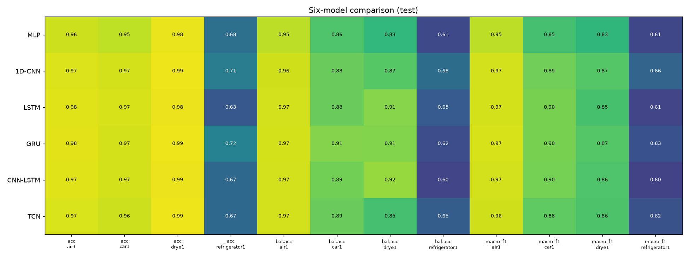

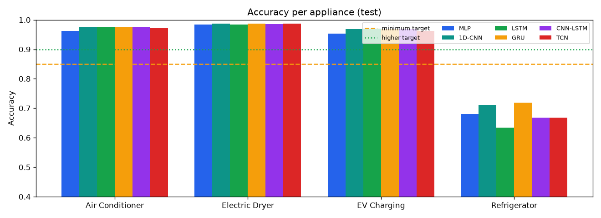

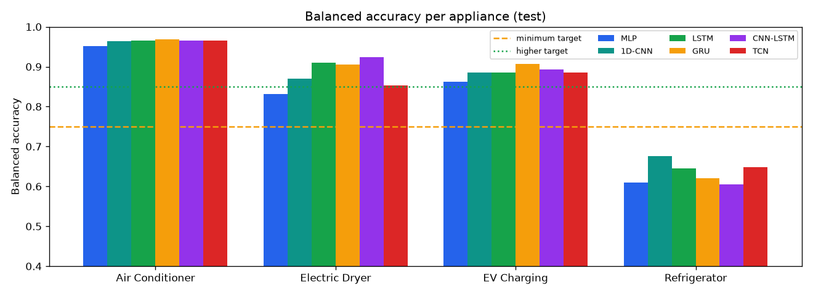

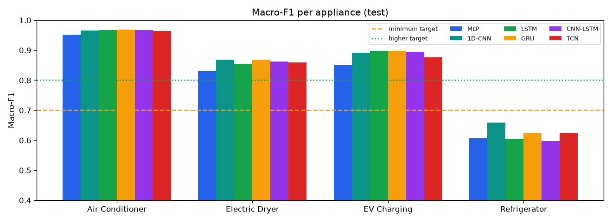

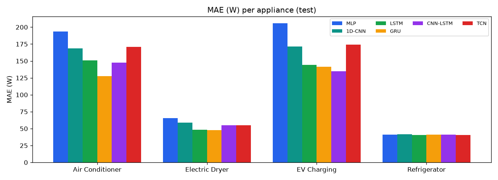

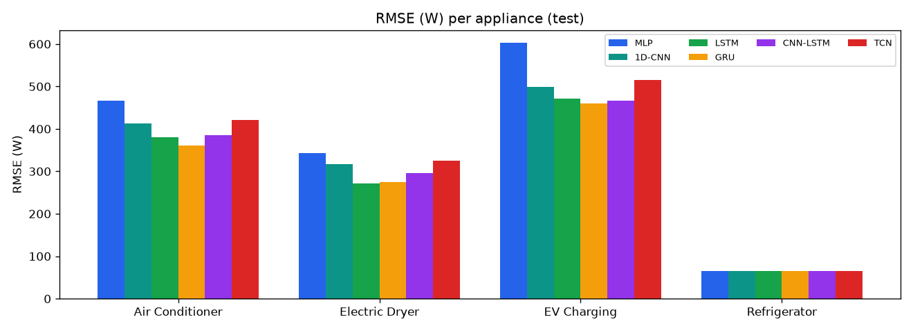

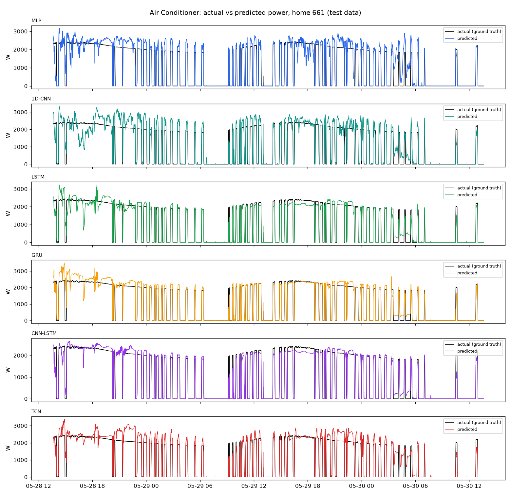

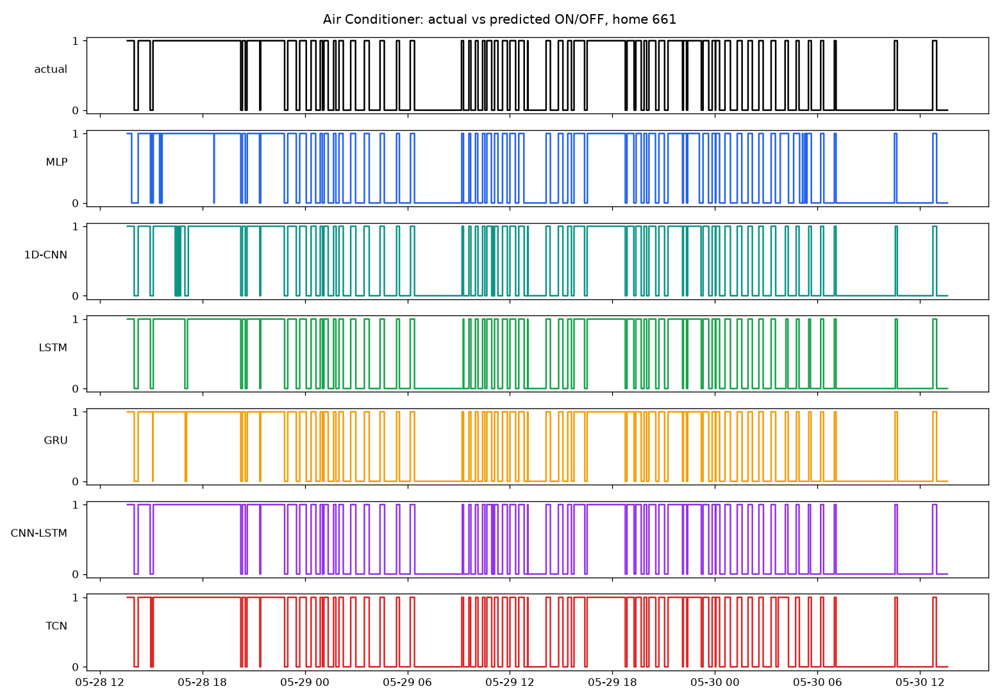

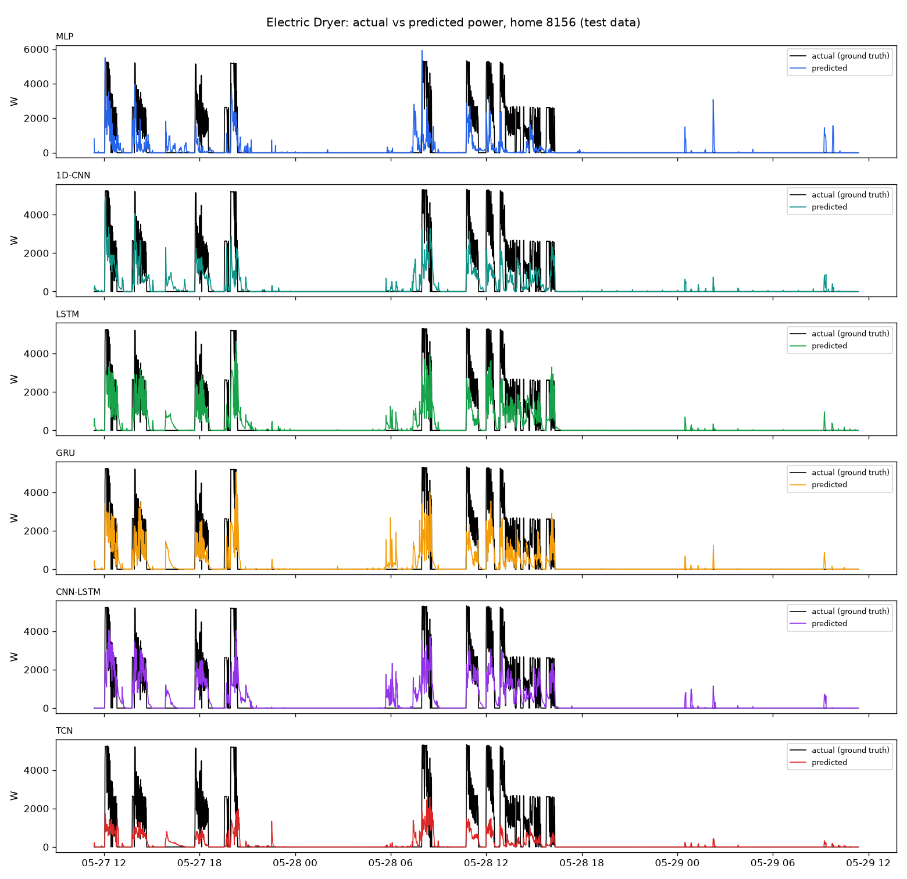

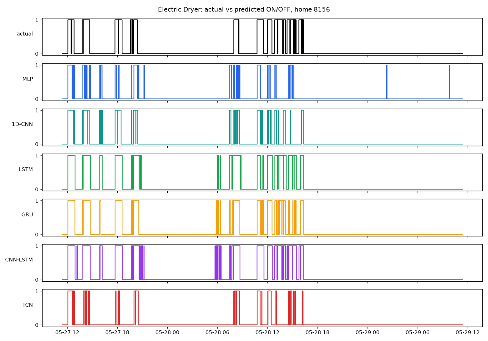

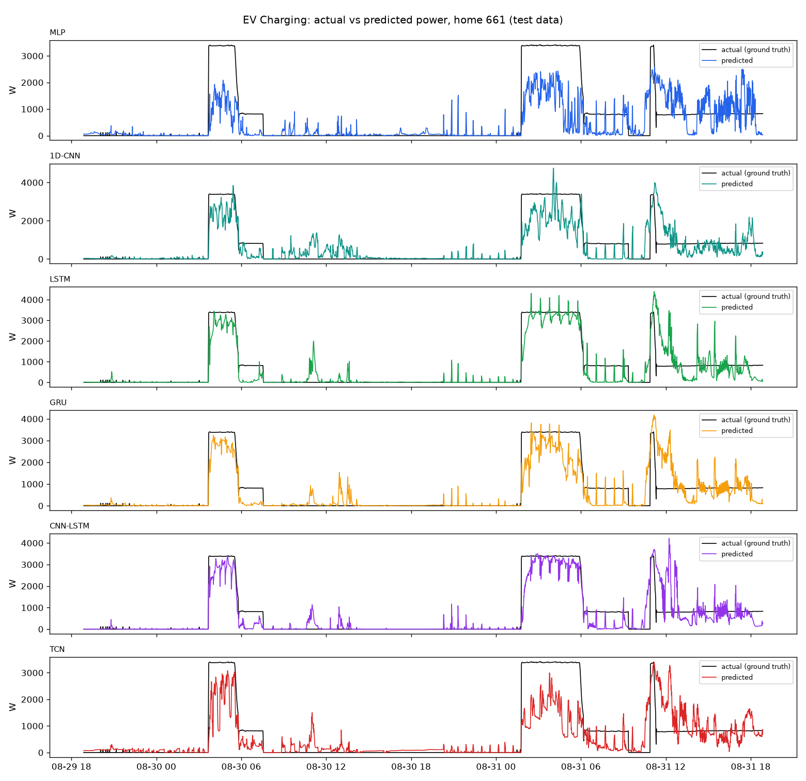

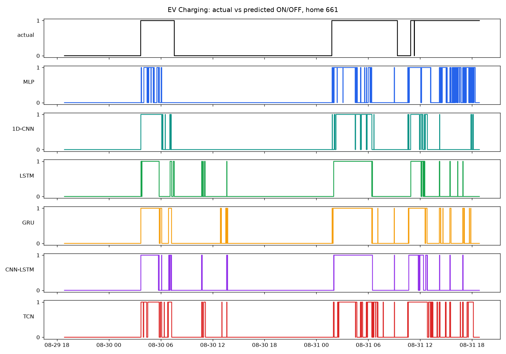

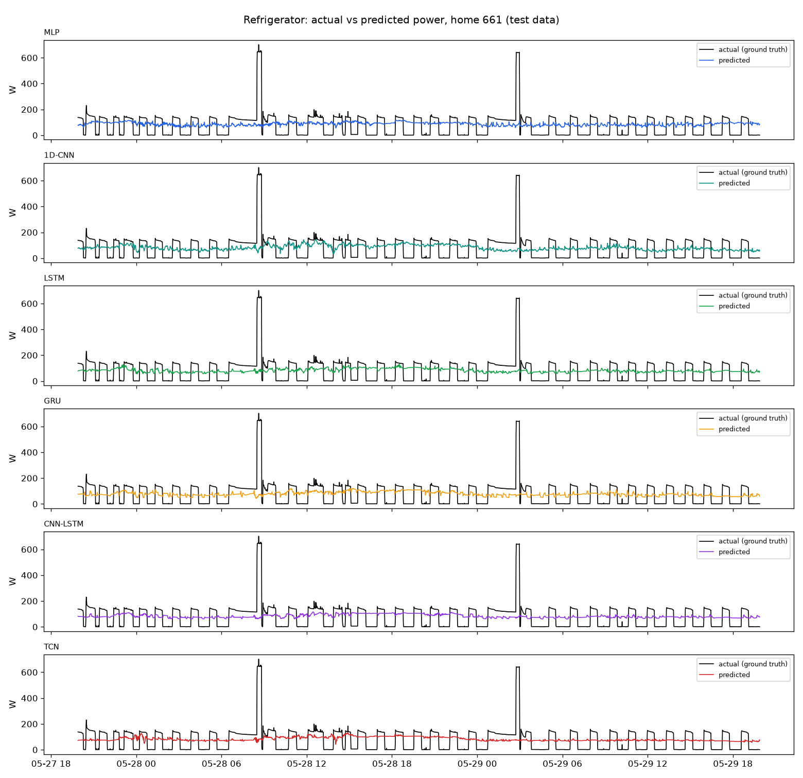

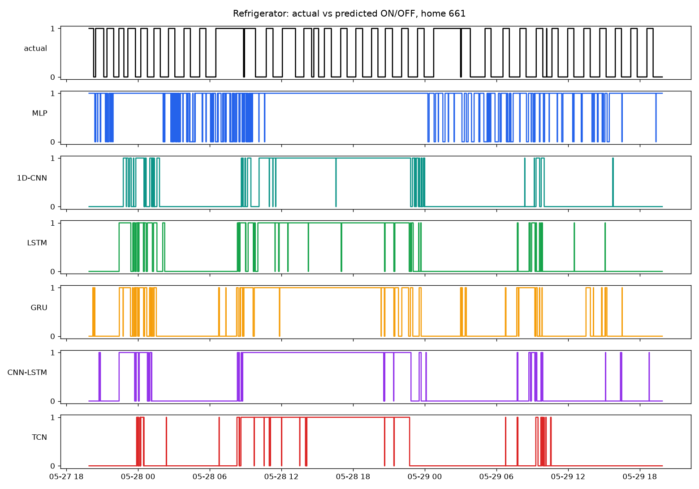

Confusion matrices: `results/figures/confusion_<model>.png`.

## 21. CCP benchmark achievement

Minimum target per appliance: Accuracy >= 85%, Balanced Accuracy >= 75%, Macro-F1 >= 0.7. Higher target: 90%, 85%, 0.8. Benchmark appliances: air1, drye1, car1.

| model | all3_meet_min | all3_meet_high | appliances_meeting_min |
|---|---|---|---|
| 1D-CNN | True | True | 3 |
| CNN-LSTM | True | True | 3 |
| GRU | True | True | 3 |
| LSTM | True | True | 3 |
| MLP | True | False | 3 |
| TCN | True | True | 3 |

## 22. Limitations

- One year (2018) of one region; results may not carry to other climates.
- Only 5 Austin homes have all three benchmark appliances active, so the development set is small.
- The monthly split keeps time order inside each month, but training and test periods are close in time (a few days apart at month boundaries).
- Models train on a random sample of training windows to fit a CPU budget.
- The refrigerator is a small load (about 100 W) inside a total of several kW, so it is much harder to detect than the other appliances.
- The unseen-home dryer test has no ON samples, so only accuracy is meaningful there.

## 23. Conclusion

6 of 6 evaluated models meet the minimum CCP benchmark on all three benchmark appliances (1D-CNN, CNN-LSTM, GRU, LSTM, MLP, TCN). See section 19 for per-appliance detail.
